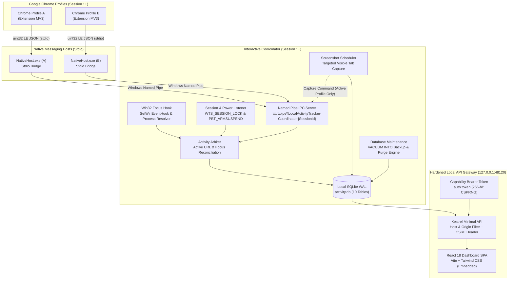

<div align="center">

# ⏱️ Local Activity Tracker (Employee Monitoring)

**Local-first, privacy-respecting activity and URL monitoring designed for Windows 10 & 11.**  
*Multi-profile Chrome tracking, active tab duration accounting, non-Chrome application usage, periodic tab screenshots, and audit-grade CSV export — 100% offline with zero cloud telemetry.*

---

[](#requirements)
[](#technology-stack)
[](#technology-stack)
[](#multi-profile-chrome-extension)
[](#persistence-layer)
[](#automated-testing--verification)
[](#privacy--security-invariants)
[](#privacy--security-invariants)

[Quick Start](#-quick-start) •
[Features](#-key-features) •
[Architecture](#-system-architecture) •
[Dashboard](#-localhost-dashboard) •
[CSV Export](#-master-csv-export-engine) •
[Privacy Guarantees](#-privacy--security-invariants) •
[Documentation](#-documentation-index)

---

</div>

## 📌 Executive Summary

Traditional monitoring agents rely on fragile Session 0 services, leak corporate data to third-party cloud analytics, and snoop on sensitive window titles or document contents. 

**Local Activity Tracker** is engineered specifically for workstation environments requiring **high-fidelity multi-profile activity audits without privacy overreach or cloud dependencies**:
- **Multi-Profile Chrome URL Tracking:** Accrues active tab durations exclusively when Chrome is focused and the tab is foregrounded.
- **Privacy-Strict Application Tracking:** Measures non-Chrome application durations (process name and friendly display name) with **strictly zero window titles, captions, or document names**.
- **Targeted Visible Tab Screenshots:** Captures periodic screenshots (default 10 minutes) routed solely to the active foreground Chrome tab — never background windows, other monitors, or desktop applications.
- **Air-Gapped & Local-First:** All data lives in a high-concurrency SQLite WAL database stored in `%LOCALAPPDATA%\LocalActivityTracker\data\activity.db`. Outbound HTTP clients, cloud telemetry, and external CDNs are 100% eliminated.
- **Hardened Local Gateway:** The embedded Kestrel API and React dashboard bind strictly to `127.0.0.1:48120` and enforce Host/Origin validation, CSRF headers, and capability tokens.
- **Audit-Grade Master CSV Export:** Produces customized multi-profile CSV exports with date-boundary clipping math, UTF-8 BOM, and defense against spreadsheet formula injection.

---

## ⚡ Quick Start

### Prerequisites
- **Operating System:** Windows 10 (Build 19041+) or Windows 11 (64-bit)
- **Runtime:** [.NET 8.0 SDK](https://dotnet.microsoft.com/download/dotnet/8.0)
- **Node.js:** v18.0+ / v20.0+ / v24.0+ & npm (for building web assets)
- **Browser:** Google Chrome (any recent stable release)

---

### Installation via PowerShell (One-Click)

Open PowerShell as your current interactive Windows user (no administrative elevation required):

```powershell
# 1. Clone the repository
git clone https://github.com/nizamuddin3080/Employee-Monitoring.git
cd Employee-Monitoring

# 2. Execute the one-click installer
.\scripts\install.ps1 -LaunchAfterInstall
```

The installer automatically:
1. Compiles the .NET 8 solution in Release mode.
2. Compiles TypeScript and bundles the Chrome Extension and React Dashboard.
3. Stages production binaries to `%LOCALAPPDATA%\LocalActivityTracker\bin`.
4. Registers the Chrome Native Messaging host in `HKCU\Software\Google\Chrome\NativeMessagingHosts`.
5. Creates an interactive Windows Startup shortcut so tracking starts on user login.
6. Hardens NTFS ACLs to isolate the data directory exclusively to your Windows user and `SYSTEM`.
7. Launches `Coordinator.exe` in the interactive desktop session with its system tray icon.

---

### Service Lifecycle Controls

```powershell
# Start the Coordinator in background
.\scripts\start.ps1

# Stop running Coordinator processes
.\scripts\stop.ps1

# Build the entire solution and execute all 114 tests
.\build.ps1

# Clean uninstall (add -PurgeData to permanently wipe local databases and screenshots)
.\scripts\uninstall.ps1
```

---

## 🧩 Multi-Profile Chrome Extension

To track multiple independent Chrome profiles (e.g. *Personal*, *Work*, *Client Admin*) on the same workstation:

```
┌────────────────────────────────────────────────────────┐
│ Chrome Extension Multi-Profile Setup                  │
├────────────────────────────────────────────────────────┤
│ 1. Open Google Chrome in the profile to monitor.       │
│ 2. Navigate to chrome://extensions/                   │
│ 3. Toggle ON "Developer mode" (top right).             │
│ 4. Click "Load unpacked" and select:                   │
│    %LOCALAPPDATA%\LocalActivityTracker\extension       │
│    (or <repo>\src\ChromeExtension\dist during dev)     │
│ 5. Click the extension toolbar icon.                   │
│ 6. Verify the badge shows "CONNECTED" with a UUID.     │
│ 7. Repeat for every Chrome profile you use.            │
└────────────────────────────────────────────────────────┘
```

Each Chrome profile generates an independent UUIDv4 stored in `chrome.storage.local`, spawning its own Native Messaging bridge and multiplexing over dedicated Named Pipe channels into the Coordinator.

---

## 🏛️ System Architecture

The application is decomposed into five distinct security boundaries:



### Key Architectural Invariants
1. **Interactive Desktop Session (Session 1+):** Runs in the logged-in user desktop session. It avoids Session 0 isolation, allowing native Win32 hooks (`EVENT_SYSTEM_FOREGROUND`) and `WTSRegisterSessionNotification` to function properly.
2. **Dual-Sourced Focus Reconciliation:** Tab duration accumulates **only** at the mathematical intersection of:
   $$\text{ForegroundWindow} == \text{Chrome HWND} \quad \land \quad \text{TabState} == \text{ACTIVE}$$
   Tabs in background Chrome windows or inactive tabs accrue **zero** active duration.
3. **Non-Chrome Minimal Privacy Invariant:** Non-Chrome applications record **only** `process_name` (e.g. `Code.exe`) and `app_name` (`Visual Studio Code`). Window titles, document paths, document names, and internal UI contents are strictly excluded across the entire stack.
4. **Offline Purity Guarantee:** There are no outbound HTTP requests, no third-party CDNs, and zero telemetry SDKs. Verified via static code audits.

---

## 💻 Localhost Dashboard

Accessible exclusively from loopback at:  
👉 **`http://127.0.0.1:48120`**

The dashboard provides six dedicated views:

| View | Capabilities |
| :--- | :--- |
| **📊 Overview** | Live KPI summary cards: Chrome Foreground Duration, Active Tab Time, Non-Chrome App Time, Enrolled Profiles, and Capture counts. |
| **🌐 Chrome Activity** | Paginated and searchable chronological table of sanitized browsing sessions, root domains, and active viewing durations. |
| **🖥️ App Usage** | Privacy-safe audit log of desktop application focus durations. Process names and friendly titles only (**strictly zero window titles**). |
| **📸 Screenshots** | Gallery grid and modal lightbox for visible tab captures. Displays profile, tab URL, dimensions, and capture timestamp. |
| **👥 Profiles** | Multi-profile management center showing connected profiles and detecting unmonitored profiles from Chrome's `Local State`. |
| **📥 Master Export** | Master multi-section CSV report generator with custom date picker, profile selector, formula injection defense, and Explorer reveal. |
| **⚙️ Settings** | Screenshot interval slider (60s–3600s), SQLite online backup (`VACUUM INTO`), data retention purges, and factory reset. |

---

## 📑 Master CSV Export Engine

The export engine generates unified, multi-section compliance spreadsheets adhering strictly to RFC-4180:

```
═══════════════════════════════════════════════════════════════════════════
SECTION 1: EXPORT METADATA & RECONCILIATION SUMMARY
Date Range UTC, Profiles Included, Total Chrome Foreground, Total Active URL
───────────────────────────────────────────────────────────────────────────
SECTION 2: PROFILES ENROLLMENT & TRACKING STATUS
Profile ID, Profile Name, Enrolled At, Last Seen At, Monitored
───────────────────────────────────────────────────────────────────────────
SECTION 3: CHROME BROWSING SESSIONS (ACTIVE URLS & DURATIONS)
Profile ID, Profile Name, URL (Sanitized), Domain, Start UTC, End UTC, Duration (s)
───────────────────────────────────────────────────────────────────────────
SECTION 4: PERIODIC TAB SCREENSHOT CAPTURES AUDIT LOG
Profile ID, Capture Time UTC, URL (Sanitized), File Path, Dimensions, Capture Status
───────────────────────────────────────────────────────────────────────────
SECTION 5: NON-CHROME DESKTOP APPLICATION USAGE (DURATION ONLY — NO TITLES)
Process Executable, Application Name, Start Time UTC, End Time UTC, Duration (s)
═══════════════════════════════════════════════════════════════════════════
```

### Safety & Mathematical Standards
- **Mathematical Boundary Clipping:** Sessions crossing date range $[T_1, T_2]$ are clipped mathematically so only the duration within the requested window is accrued:
  $$D_{\text{clipped}} = \max\left(0, \min(T_{\text{end}}, T_2) - \max(T_{\text{start}}, T_1)\right)$$
- **Excel Formula Injection Neutralization:** Any text field beginning with `=`, `+`, `-`, `@`, `\t`, or `\r` is automatically prepended with a single quote (`'`), ensuring Microsoft Excel displays values as inert text without executing macros or DDE commands.
- **UTF-8 Byte Order Mark (BOM):** Every CSV file begins with `0xEF, 0xBB, 0xBF` for consistent encoding and display across international versions of Excel and LibreOffice.

---

## 🔒 Privacy & Security Invariants

| Security Dimension | Technical Implementation |
| :--- | :--- |
| **Zero Window Titles** | Complete schema, model, and API absence of window title fields. Enforced by automated reflection and schema migration unit tests. |
| **URL Query Sanitization** | Automatic redaction of sensitive query parameters across 40+ authentication patterns (`token`, `access_token`, `auth`, `key`, `password`, `code`, `session`, `sig`, etc.). |
| **Loopback Authorization** | Kestrel listens strictly on `127.0.0.1:48120`. Rejects external host headers (`Host: evil.com`), validates Origin headers, and requires custom header `X-LAT-Requested-With: LocalActivityTracker`. |
| **Capability Bearer Token** | 256-bit CSPRNG token generated on startup at `%LOCALAPPDATA%\LocalActivityTracker\config\auth.token`. Required for all administrative and data export endpoints. |
| **NTFS Directory ACLs** | Storage directory ownership is locked to the executing user identity and Windows `SYSTEM`, with inheritance stripped to prevent lateral access on multi-user systems. |
| **Targeted Screenshot Routing** | Tab captures utilize `chrome.tabs.captureVisibleTab` directed only to the active tab of the foreground Chrome window. Background tabs, restricted schemes (`chrome://`), and desktop windows cannot be captured. |
| **Honest Coverage Auditing** | Scans Chrome's `Local State` file to discover all local browser profiles, alerting administrators to any untracked profiles. |

---

## 🗄️ Persistence Layer

The SQLite database (`activity.db`) operates in **Write-Ahead Logging (WAL)** mode with a busy timeout of 5000ms:

```sql
PRAGMA journal_mode = WAL;
PRAGMA synchronous = NORMAL;
PRAGMA foreign_keys = ON;
PRAGMA busy_timeout = 5000;
```

### Database Tables (10 Tables)
1. `chrome_profiles` — Enrolled Chrome profile identities and metadata.
2. `browser_windows` — Tracked Chrome window handles, profile mappings, and focus states.
3. `browser_sessions` — Browser-level foreground focus intervals.
4. `url_activity_sessions` — Active URL viewing sessions with domain and duration.
5. `application_sessions` — Non-Chrome foreground application sessions (**no `window_title`**).
6. `screenshot_metadata` — Audit log of visible tab capture attempts, dimensions, and statuses.
7. `tab_events` — Ephemeral raw tab lifecycle events (navigation, activation, close).
8. `application_settings` — Key-value configuration store (intervals, retention policies).
9. `schema_migrations` — Applied database migration version tracking.
10. `database_backups` — History of hot SQLite online backups (`VACUUM INTO`).

---

## 🧪 Automated Testing & Verification

The repository includes a test suite with **114 automated unit, integration, and end-to-end tests**:

```powershell
# Run the complete test suite in Release configuration
dotnet test .\tests\LocalActivityTracker.Tests\LocalActivityTracker.Tests.csproj -c Release
```

```text
Starting test execution, please wait...
A total of 1 test files matched the specified pattern.

Passed!  - Failed: 0, Passed: 114, Skipped: 0, Total: 114, Duration: 2 s - LocalActivityTracker.Tests.dll (net8.0)
```

### Test Coverage Highlights
- **Persistence:** SQLite WAL mode concurrency, busy timeout contention, table schema validation, and dangling crash recovery (`RECOVERED_AFTER_CRASH`).
- **Win32 & Arbitration:** Focus hook event handling, process name resolution, dual-sourced duration accrual, and background tab exclusion.
- **Privacy Enforcement:** Automated reflection test scanning all Core and Coordinator types ensuring zero occurrences of `window_title`.
- **IPC Reliability:** Native Messaging uint32 LE framing, Named Pipe client-server multiplexing, and 100-event offline buffer drain.
- **API Security Gateway:** Host header spoofing defense, Origin check validation, CSRF custom header enforcement, and bearer token rejection.
- **CSV Engine:** Boundary clipping math, RFC-4180 quotation, Excel formula injection neutralization, and 5-section formatting.

---

## 📂 Project Directory Structure

```text
.
├── .agents/                        # Specialized agent and skill configurations
├── docs/                           # Static security and privacy audit reports
│   └── zero-telemetry-audit.md     # 100% offline code verification audit
├── scripts/                        # Production deployment and operational automation
│   ├── install.ps1                 # One-click Windows 10/11 installer
│   ├── uninstall.ps1               # Clean service uninstaller (-PurgeData option)
│   ├── start.ps1                   # Background Coordinator launcher
│   ├── stop.ps1                    # Graceful Coordinator shutdown
│   └── harden-storage-acl.ps1      # NTFS permissions hardening script
├── src/
│   ├── ChromeExtension/            # TypeScript Manifest V3 extension
│   │   ├── public/manifest.json    # Chrome extension manifest
│   │   ├── src/background.ts       # Service worker & Native Messaging client
│   │   ├── src/popup.ts            # Extension enrollment status popup
│   │   ├── src/profile.ts          # Profile UUID management
│   │   └── src/url-sanitizer.ts    # In-extension query param sanitizer
│   ├── Coordinator/                # Interactive desktop host & background worker
│   │   ├── Api/                    # Hardened Kestrel API host & security middleware
│   │   ├── CoordinatorApp.cs       # Master runtime orchestrator & message pump
│   │   └── Program.cs              # Application entry point (Session 1+)
│   ├── Core/                       # Shared domain models, persistence, and IPC
│   │   ├── Arbitration/            # Focus & active URL reconciliation engine
│   │   ├── Database/               # SQLite migrations, factory, and maintenance
│   │   ├── Export/                 # Master CSV generator & formula defense
│   │   ├── Ipc/                    # Windows Named Pipe server and framing
│   │   ├── Models/                 # Immutable domain entities
│   │   ├── Privacy/                # Server-side URL sanitizer & redaction
│   │   ├── Profiles/               # Chrome Local State scanner
│   │   ├── Repositories/           # Parameterized SQLite data access
│   │   └── Win32/                  # Native focus hooks, tray icon, & WTS listener
│   ├── LocalDashboard/             # React 18 / Tailwind CSS dashboard SPA
│   │   ├── src/api/client.ts       # Hardened loopback REST client
│   │   ├── src/components/         # Modular dashboard views
│   │   └── src/App.tsx             # Root dashboard container
│   └── NativeHost/                 # Chrome stdio-to-NamedPipe bridge
│       ├── NativeMessagingBridge.cs# Offline buffer and Named Pipe client
│       └── Program.cs              # Native Messaging host entry point
├── tests/
│   └── LocalActivityTracker.Tests/ # 114 automated xUnit test fixtures
├── LocalActivityTracker.sln        # Visual Studio / .NET 8 solution
├── build.ps1                       # Complete full-stack build script
├── clean.ps1                       # Clean solution build artifacts
└── README.md                       # This document
```

---

## 📖 Documentation Index

For in-depth architectural specifications and compliance matrices, consult the engineering documentation:

| Specification | Description |
| :--- | :--- |
| [**Architecture Guide**](architecture.md) | High-level system design, IPC protocols, and threading models. |
| [**API Contracts**](api-contracts.md) | JSON schemas for stdio, Named Pipes, and REST API endpoints. |
| [**Database Schema**](database-schema.md) | SQLite 10-table relational schema and indexing strategy. |
| [**Privacy & Security**](privacy-security.md) | Hardening standards, anti-surveillance policies, and ACL rules. |
| [**Zero-Telemetry Audit**](docs/zero-telemetry-audit.md) | Source code audit confirming zero external network calls. |
| [**Architecture Decisions (ADRs)**](decisions.md) | Architecture Decision Records (ADR-001 through ADR-012). |
| [**Requirements Traceability**](requirements-traceability.md) | Bidirectional mapping of requirements REQ-01 through REQ-15. |
| [**Testing Strategy**](testing.md) | Automated testing methodologies, test matrices, and fixtures. |
| [**Task Ledger**](task.md) | Execution backlog of all 75 engineering tasks. |
| [**Progress History**](progress.md) | Phase-by-phase implementation and verification milestones. |

---

## ⚖️ License & Privacy Commitment

This software is released under the **MIT License**.

**Privacy Guarantee:** This software is designed with an explicit commitment to privacy-respecting local monitoring. It **never** transmits telemetry, analytics, URLs, screenshots, or application data outside the local workstation. Non-Chrome application titles and document contents are **strictly unmonitored**.
