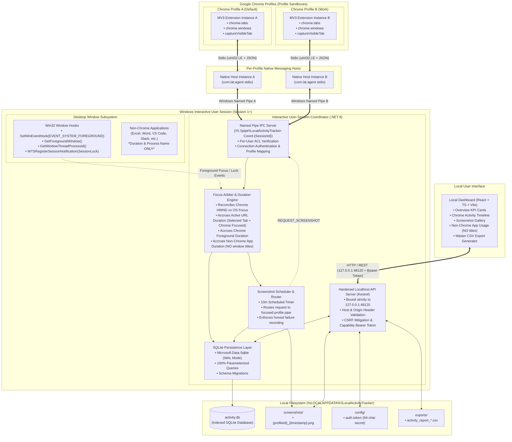

# Technical Architecture — Local Activity Tracker

> **System Design, Component Specifications, Interactive Session IPC, and Security Architecture**  
> *Target Platform: Windows 10 & 11 (x64) \| Interactive User Session Architecture (Session 1+)*

---

## 1. High-Level Architectural Overview

Local Activity Tracker employs a multi-tier, local-only desktop-browser architecture explicitly designed for the **Windows interactive user session (Session 1+)**. It resolves session isolation limitations by decomposing responsibilities across three distinct tiers:

1. **Chrome Extensions (Manifest V3):** Enrolled separately within each local Google Chrome profile to observe tab navigation, window selection, and visible tab captures.
2. **Native Messaging Host Instances:** Individual lightweight bridge processes launched by Chrome per profile extension. Each instance communicates with its browser extension over standard I/O and bridges messages to the central coordinator over authenticated Windows Named Pipes.
3. **Interactive User-Session Coordinator (C# / .NET 8):** Executes strictly within the user's interactive Windows logon session (Session 1+). It arbitrates Win32 foreground window hooks, manages the SQLite repository, coordinates duration accounting, schedules and routes profile-specific screenshots, and exposes a hardened local dashboard API.
4. **Local Dashboard (React + TypeScript):** An offline, modern web interface served directly via loopback (`127.0.0.1:48120`), protected by Host/Origin validation, CSRF defenses, and local capability token authorization.

### Core Architecture Diagram



---

## 2. Interactive Session Placement & Responsibilities

### 2.1 The Session 0 Problem & Interactive Placement
A conventional Windows Service runs in **Session 0**, which is isolated from the interactive user desktop. In Session 0:
- `GetForegroundWindow()` returns `NULL` or an irrelevant Session 0 desktop handle.
- `SetWinEventHook(EVENT_SYSTEM_FOREGROUND)` cannot listen to the logged-in user's desktop events.
- UI Automation and window handle queries fail.

**Architectural Decision (ADR-001):** The core background engine is implemented as the **Interactive User-Session Coordinator** (`LocalActivityTracker.Coordinator.exe`). It executes strictly in the active user's interactive logon session (Session 1+), launched via the per-user Windows Startup registry key (`HKCU\Software\Microsoft\Windows\CurrentVersion\Run`) or a user-session Task Scheduler job.

### 2.2 Coordinator Responsibilities
1. **Foreground Window Monitoring:** Runs Win32 `SetWinEventHook(EVENT_SYSTEM_FOREGROUND)` to capture window activation events with sub-100ms latency.
2. **Executable Resolution:** Resolves active window handles via `GetWindowThreadProcessId` and `QueryFullProcessImageName` to obtain the executable filename (e.g. `chrome.exe`, `Code.exe`).
3. **Session State Monitoring:** Uses `WTSRegisterSessionNotification` to listen for `WTS_SESSION_LOCK` and `WTS_SESSION_UNLOCK`, and `SystemEvents.PowerModeChanged` for sleep/suspend. All active tracking intervals immediately pause on lock or suspend.
4. **Duration Arbitration:** Accrues active URL time only when Chrome is the foreground OS window and the tab is selected. Accrues non-Chrome duration for other apps.
5. **IPC Pipe Server:** Hosts the Named Pipe server (`\\.\pipe\LocalActivityTracker-Coordinator-{SessionId}`) accepting connections from profile Native Messaging hosts.
6. **Screenshot Scheduling & Targeted Routing:** Dispatches capture requests across the specific Named Pipe corresponding to the currently focused Chrome profile.
7. **Database Ownership:** Sole owner and writer of `%LOCALAPPDATA%\LocalActivityTracker\data\activity.db`.
8. **Hardened Localhost API:** Exposes endpoints on `127.0.0.1:48120` secured with Host/Origin validation, CSRF headers, and capability tokens.

---

## 3. Multi-Host Named Pipe IPC Architecture

Chrome launches an independent Native Messaging host process for each profile extension. The Coordinator multiplexes these independent instances using Windows Named Pipes.

```mermaid
sequenceDiagram
    autonumber
    participant Ext as Chrome Extension (Profile A)
    participant NH as Native Host Instance A
    participant Coord as Interactive Coordinator
    participant Win32 as Win32 Desktop Subsystem

    Note over NH,Coord: Coordinator initializes Named Pipe Server on startup
    NH->>NH: Launched by Chrome via Stdio
    NH->>Coord: Connect to \\.\pipe\LocalActivityTracker-Coord-{SessionId}
    
    rect rgb(240, 248, 255)
        Note over Coord: Connection Authentication
        Coord->>Coord: GetNamedPipeClientProcessId(pipeHandle)
        Coord->>Coord: Verify Client Process Token matches Current User SID
    end

    NH->>Coord: IPC_HANDSHAKE {protocol_version: "1.0", profile_id: "uuid-A", profile_name: "Default"}
    Coord-->>NH: IPC_HANDSHAKE_ACK {status: "CONNECTED", screenshot_interval_sec: 600}

    Note over Ext,NH: Tab Navigated Event in Chrome
    Ext->>NH: Stdio: TAB_NAVIGATED {profile_id, tab_id, url, domain, title}
    NH->>Coord: Pipe: EVENT_TAB_NAVIGATED {correlation_id, profile_id, tab_id, url, domain, title}

    rect rgb(255, 250, 240)
        Note over Coord,Win32: Focus Reconciliation
        Win32->>Coord: EVENT_SYSTEM_FOREGROUND (HWND)
        alt Chrome is Foreground & Tab is Active
            Coord->>Coord: Accrue Active URL Duration on Profile A
        else Another Application is Foreground
            Coord->>Coord: Buffer tab state; Accrue Non-Chrome App Duration (NO window titles)
        end
    end

    Note over Coord,NH: Scheduled Screenshot (10 min)
    Coord->>NH: Pipe: REQUEST_SCREENSHOT {correlation_id: "req-101", profile_id: "uuid-A"}
    NH->>Ext: Stdio: CAPTURE_SCREENSHOT_REQUEST {capture_id: "req-101"}
    Ext->>Ext: chrome.tabs.captureVisibleTab()
    alt Capture Permitted
        Ext->>NH: Stdio: SCREENSHOT_CAPTURED {capture_id, base64_image, url}
        NH->>Coord: Pipe: RESPONSE_SCREENSHOT {correlation_id, status: "SUCCESS", base64_image, url}
        Coord->>Coord: Save PNG to disk; write metadata to SQLite
    else Capture Restricted / Hidden
        Ext->>NH: Stdio: SCREENSHOT_FAILED {capture_id, failure_code: "RESTRICTED_URL"}
        NH->>Coord: Pipe: RESPONSE_SCREENSHOT {correlation_id, status: "RESTRICTED", failure_reason}
        Coord->>Coord: Write failure row to SQLite (honest reporting)
    end
```

### 3.1 Named Pipe Specifications
- **Pipe Naming Strategy:**
  `\\.\pipe\LocalActivityTracker-Coordinator-{SessionId}`
  Where `{SessionId}` is the Windows Terminal Services interactive session ID (e.g., `1`). This prevents cross-session collision in multi-user or Fast User Switching environments.
- **Security Descriptor & Access Control:**
  The pipe server is created with a discretionary access control list (DACL) granting `GENERIC_READ | GENERIC_WRITE` **exclusively to the current user's security identifier (SID)** and `NT AUTHORITY\SYSTEM`. Connections from other user accounts or network callers (`FILE_PIPE_REJECT_REMOTE_CLIENTS`) are denied at the OS level.
- **Client Identity Verification:**
  Upon client connection, the Coordinator calls `GetNamedPipeClientProcessId` and inspects the client process owner token. If the process does not belong to the current user SID, the connection is immediately terminated.
- **Protocol Framing & Limits:**
  - **Framing:** 4-byte unsigned little-endian integer prefix indicating message byte length, followed by UTF-8 encoded JSON.
  - **Size Limit:** Capped at 4,194,304 bytes (4 MB) to accommodate base64-encoded PNG screenshots. General telemetry messages are capped at 64 KB.
- **Correlation IDs:**
  Every command/response interaction (such as screenshot requests) carries a unique `correlation_id` (UUIDv4) to guarantee deterministic pairing and prevent race conditions.
- **Coordinator Unavailable Buffering & Reconnection:**
  If Chrome launches before the Coordinator or if the Coordinator restarts, the Native Host buffers up to 100 recent events in memory and attempts reconnection with exponential backoff (1s, 2s, 4s... max 30s). When the buffer overflows, oldest events are dropped with an honesty warning flag.

---

## 4. Local Screenshot Pipeline & Routing Rules

### 4.1 Targeted Profile Screenshot Routing
1. The Coordinator maintains a 10-minute timer.
2. When the timer fires, the Coordinator queries the current foreground window.
3. If Chrome is the foreground window, the Coordinator identifies which enrolled profile owns that window.
4. The Coordinator routes `REQUEST_SCREENSHOT` across the specific Named Pipe connected to that profile's Native Host.
5. The Native Host bridges the command to the extension via Stdio.
6. The extension calls `chrome.tabs.captureVisibleTab(null, { format: 'png' })`.
7. The base64 PNG data is sent over the pipe, decoded by the Coordinator, and saved directly to `%LOCALAPPDATA%\LocalActivityTracker\screenshots\{profile_id}_{timestamp}_{guid}.png`.

### 4.2 Screenshot Constraints & Honest Reporting
- **Visible Tab Only:** Captures can only occur on the active, visible tab in the foreground Chrome window. Hidden tabs, background tabs, and occluded windows cannot be captured.
- **No Guaranteed Screenshots:** The application **never** promises guaranteed screenshots if the browser is minimized, locked, occluded, or navigated to internal restricted pages (`chrome://*`, `about:blank`, Chrome Web Store).
- **Truthful Status Logging:** Every attempt records an explicit status in SQLite:
  - `SUCCESS`: Image captured and saved to disk.
  - `RESTRICTED_URL`: Tab is on a page blocked by Chrome security.
  - `WINDOW_OCCLUDED_OR_MINIMIZED`: Window was not visible to the user.
  - `NO_EXTENSION_CONNECTED`: Target profile extension was disconnected.
  - `CAPTURE_TIMEOUT`: Extension did not respond within 15 seconds.
  - `STORAGE_WRITE_FAILURE`: Local disk write failed.
- **Zero Desktop / Other Application Captures:** The application contains zero GDI or DirectX desktop capture code (`BitBlt`, `CreateCompatibleDC`). Only Chrome's authorized tab API is used.
- **Log Hygiene:** Image base64 payloads are **never** logged to diagnostic text logs.

---

## 5. Non-Chrome Application Tracking (Duration Only)

### 5.1 Strict Data Collection Boundary
To respect user privacy while providing accurate desktop time allocation, tracking of applications other than Google Chrome is strictly limited to:
- **Process Executable Name:** (e.g. `Code.exe`, `EXCEL.EXE`, `slack.exe`).
- **Application Display Name:** Clean product name resolved from the executable's version resource (e.g. `Visual Studio Code`, `Microsoft Excel`). If unresolvable, falls back to the executable name.
- **Start Timestamp & End Timestamp:** UTC timestamps marking when the application gained and lost OS foreground focus.
- **Duration Seconds:** Exact elapsed foreground time.
- **Session Status:** (`COMPLETED`, `ACTIVE`, `RECOVERED_AFTER_CRASH`).

### 5.2 Explicit Exclusions
The following data points are **never collected, never stored, and never exported**:
- ❌ **Window Titles / Captions** (`window_title` is completely eliminated).
- ❌ **Document Names & File Paths** (e.g., `Q3_Financials.xlsx` is never recorded).
- ❌ **Email Subjects & Chat Content** (e.g., Teams/Slack message titles are never inspected).
- ❌ **Application Internal Contents & URLs**.
- ❌ **Keystrokes, Mouse Coordinates, Clipboard Data, or Passwords**.
- ❌ **Screenshots of Non-Chrome Applications**.

When the user switches from Chrome to Excel, active URL time pauses immediately, and an `application_sessions` record accumulates elapsed time for `EXCEL.EXE`. When the user returns to Chrome, the Excel session closes, and URL tracking resumes. Chrome is explicitly excluded from the `application_sessions` table.

---

## 6. Localhost Dashboard & API Security Specification

Binding a local server to `127.0.0.1` restricts network access to the local machine, but does not prevent malicious websites executing in the user's browser from issuing cross-origin HTTP requests. The local API implements defense-in-depth security controls:

### 6.1 Binding & Network Isolation
- The Kestrel server binds exclusively to `http://127.0.0.1:48120`.
- It **never** binds to `0.0.0.0`, `localhost` (which might resolve to IPv6 `[::1]` inconsistently), or any external network interface.

### 6.2 Host & Origin Header Validation
- **Host Header Validation:** Incoming requests must have a `Host` header strictly matching `127.0.0.1:48120` or `localhost:48120`. Any request with an unexpected or forged Host header (such as in DNS rebinding attacks) is rejected with `400 Bad Request`.
- **Origin Header Validation:** 
  - Production Origin: Only `http://127.0.0.1:48120` or `http://localhost:48120` are permitted.
  - Development Origin: `http://localhost:5173` is permitted **only** when `ASPNETCORE_ENVIRONMENT=Development`.
  - Wildcard CORS (`*`) is strictly prohibited. Requests from arbitrary browser origins (e.g., `http://malicious-site.com`) are rejected with `403 Forbidden`.

### 6.3 Cross-Site Request Forgery (CSRF) Mitigation
- All state-changing endpoints (`POST`, `PUT`, `DELETE`) require a custom header:
  `X-LAT-Requested-With: LocalActivityTracker`
- Browser cross-origin `fetch` or `XMLHttpRequest` cannot set custom headers without triggering a CORS preflight (`OPTIONS`) request, which is rejected by the strict Origin validation rules.
- HTML form submissions (`<form method="POST">`) cannot set custom headers and are blocked.

### 6.4 Local API Capability Token Authorization
1. Upon first startup, the Coordinator generates a cryptographically secure 256-bit random token (hex-encoded, 64 characters).
2. The token is saved to `%LOCALAPPDATA%\LocalActivityTracker\config\auth.token` with NTFS permissions restricted exclusively to the current user.
3. When the user launches the dashboard, the static HTML container retrieves the token via an authenticated local launch bootstrap or prompts the user once to authenticate.
4. Subsequent API requests must supply the token in the header:
   `Authorization: Bearer <LAT_CAPABILITY_TOKEN>`
5. Any request lacking a valid bearer token to sensitive endpoints (`/api/export/*`, `/api/screenshots/*`, `/api/data/*`, `/api/settings/*`, `/api/tracking/*`) returns `401 Unauthorized`.
6. Tokens are never passed in URL query strings and never written to diagnostic logs.

### 6.5 Request Size & Rate Limits
- Standard JSON API payloads are capped at 100 KB.
- Screenshot upload over IPC is handled via internal Named Pipes (not the public dashboard HTTP server).
- Rate limiting protects SQLite from denial-of-service loops (max 60 requests/minute per endpoint).

---

## 7. Master CSV Export Architecture

### 7.1 Unified Single-File Structure
The export engine generates a single consolidated CSV file adhering to RFC 4180 with UTF-8 BOM, structured into 5 clear sections:

```csv
# SECTION: REPORT_METADATA
Key,Value
Report Generated,"2026-10-22 15:30:00"
Date Range Selected,"2026-10-01 to 2026-10-22"
Timezone,"UTC+06:00 (Bangladesh Standard Time)"
Total Profiles Enrolled,2

# SECTION: PROFILE_SUMMARY
Profile ID,Profile Name,Total Active URL Time (s),Total Chrome Foreground Time (s),URL Visits,Successful Screenshots,Failed Screenshots
"f47ac10b-58cc-4372-a567-0e02b2c3d479","Default",14250,18900,342,24,2
"c9b3a1a0-1234-4567-89ab-cdef01234567","Work Profile",28400,32100,610,48,0

# SECTION: CHROME_PROFILE: f47ac10b-58cc-4372-a567-0e02b2c3d479 (Default)
Profile ID,Profile Name,Date,Start Time,End Time,Duration Seconds,Page Title,URL,Domain,Session Status
"f47ac10b-58cc-4372-a567-0e02b2c3d479","Default","2026-10-22","09:15:00","09:25:30",630,"GitHub: Where the world builds software","https://github.com/","github.com","COMPLETED"

# SECTION: CHROME_PROFILE: c9b3a1a0-1234-4567-89ab-cdef01234567 (Work Profile)
Profile ID,Profile Name,Date,Start Time,End Time,Duration Seconds,Page Title,URL,Domain,Session Status
"c9b3a1a0-1234-4567-89ab-cdef01234567","Work Profile","2026-10-22","10:00:00","10:45:00",2700,"Jira Software - Board","https://company.atlassian.net/jira","company.atlassian.net","COMPLETED"

# SECTION: SCREENSHOT_METADATA
Profile ID,Profile Name,Capture Timestamp,Associated URL,Local Screenshot Path,Capture Status,Failure Reason
"f47ac10b-58cc-4372-a567-0e02b2c3d479","Default","2026-10-22 09:20:00","https://github.com/","C:\Users\h\AppData\Local\LocalActivityTracker\screenshots\f47ac10b_20261022T092000Z.png","SUCCESS",""

# SECTION: NON_CHROME_APPLICATION_USAGE
Application Name,Executable,Date,Start Time,End Time,Duration Seconds,Session Status
"Visual Studio Code","Code.exe","2026-10-22","11:00:00","12:30:00",5400,"COMPLETED"
"Microsoft Excel","EXCEL.EXE","2026-10-22","13:30:00","14:15:00",2700,"COMPLETED"
```

### 7.2 Date Boundary Clipping & Formula Defense
- Sessions overlapping date boundaries $[T_{start}^{UTC}, T_{end}^{UTC}]$ are strictly clipped to the boundary without inventing timestamps. Clipped sessions are marked `CLIPPED_BOUNDARY`.
- Any field starting with `=`, `+`, `-`, `@`, `\t`, or `\r` is automatically prepended with a single quote (`'`) to neutralize CSV formula injection in Microsoft Excel.

---

## 8. Windows Lifecycle & Error Recovery

1. **Session Lock / Unlock:**
   - The Coordinator registers via `WTSRegisterSessionNotification(hWnd, NOTIFY_FOR_THIS_SESSION)`.
   - On `WTS_SESSION_LOCK`: All active URL and application sessions are closed immediately. Active duration accrual is suspended.
   - On `WTS_SESSION_UNLOCK`: Foreground focus is re-evaluated afresh.
2. **System Sleep / Resume:**
   - Listens to `SystemEvents.PowerModeChanged`.
   - On `Suspend`: Open sessions flushed with current timestamp.
   - On `Resume`: Focus re-polled. Zero time accrued during sleep.
3. **Abrupt Shutdown / Crash Recovery:**
   - Sessions are opened with `is_completed = 0`.
   - Periodic heartbeats update `last_heartbeat_utc`.
   - On Coordinator startup, any dangling uncompleted session is closed with `end_time_utc = last_heartbeat_utc` and marked `RECOVERED_AFTER_CRASH`.
4. **Honest Coverage Limitations:**
   - If Windows foreground window cannot be correlated to a Chrome profile (e.g. during rapid Alt-Tab or OS shell animations), the interval is flagged as `UNRESOLVED_FOCUS` rather than fabricated.
