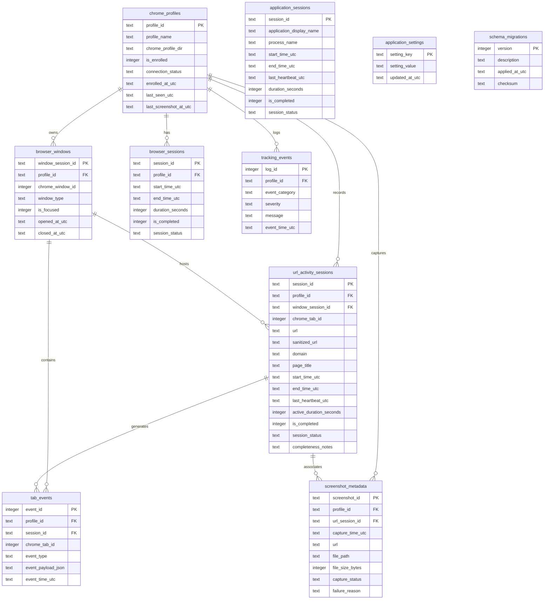

# Database Schema Specification — Local Activity Tracker

> **SQLite Database Architecture, Table Definitions, Indexes, Migrations, and Duration Mathematics**  
> *Storage Engine: SQLite 3 (`Microsoft.Data.Sqlite`) \| Journal Mode: WAL \| Timezone: UTC*

---

## 1. Storage Architecture & Configuration

The local SQLite database serves as the single authoritative source of truth for all activity tracking, screenshot metadata, and application configuration. It is owned and managed exclusively by the Interactive User-Session Coordinator.

- **Primary Database File:** `%LOCALAPPDATA%\LocalActivityTracker\data\activity.db`
- **WAL Journal File:** `%LOCALAPPDATA%\LocalActivityTracker\data\activity.db-wal`
- **Shared Memory File:** `%LOCALAPPDATA%\LocalActivityTracker\data\activity.db-shm`

### Recommended SQLite PRAGMAs
Executed immediately upon every database connection initialization:
```sql
PRAGMA journal_mode = WAL;            -- High-concurrency write-ahead logging
PRAGMA synchronous = NORMAL;           -- High write performance with full WAL durability
PRAGMA foreign_keys = ON;              -- Enforce relational integrity
PRAGMA busy_timeout = 5000;            -- 5-second wait before throwing database locked exception
PRAGMA temp_store = MEMORY;            -- Temporary indices and tables kept in memory
PRAGMA cache_size = -64000;            -- 64 MB memory cache allocation
```

---

## 2. Entity-Relationship Diagram (Mermaid)



---

## 3. Detailed Table Specifications

### 3.1 `chrome_profiles`
Maintains the registry of enrolled Chrome profiles and their connection health.

```sql
CREATE TABLE IF NOT EXISTS chrome_profiles (
    profile_id TEXT PRIMARY KEY,                       -- Persistent UUID generated in extension storage
    profile_name TEXT NOT NULL,                        -- User-friendly profile label (e.g. "Work", "Default")
    chrome_profile_dir TEXT NULL,                      -- Directory name (e.g. "Profile 1", "Default")
    is_enrolled INTEGER NOT NULL DEFAULT 1,            -- 1 = Enrolled, 0 = Paused / Unenrolled
    connection_status TEXT NOT NULL DEFAULT 'OFFLINE', -- 'CONNECTED', 'DISCONNECTED', 'OFFLINE'
    enrolled_at_utc TEXT NOT NULL,                     -- ISO-8601 UTC timestamp
    last_seen_utc TEXT NOT NULL,                       -- ISO-8601 UTC timestamp of last heartbeat
    last_screenshot_at_utc TEXT NULL                   -- ISO-8601 UTC timestamp of last successful capture
);

CREATE INDEX IF NOT EXISTS idx_chrome_profiles_last_seen ON chrome_profiles(last_seen_utc);
```

---

### 3.2 `browser_windows`
Tracks Chrome window instances across enrolled profiles.

```sql
CREATE TABLE IF NOT EXISTS browser_windows (
    window_session_id TEXT PRIMARY KEY,                -- UUID for window tracking instance
    profile_id TEXT NOT NULL,                          -- Associated profile ID
    chrome_window_id INTEGER NOT NULL,                 -- Window ID provided by chrome.windows API
    window_type TEXT NOT NULL DEFAULT 'normal',        -- 'normal', 'popup', 'app'
    is_focused INTEGER NOT NULL DEFAULT 0,             -- 1 = Focused, 0 = Blurred
    opened_at_utc TEXT NOT NULL,                       -- Window creation timestamp
    closed_at_utc TEXT NULL,                           -- Window closure timestamp
    FOREIGN KEY (profile_id) REFERENCES chrome_profiles(profile_id) ON DELETE CASCADE
);

CREATE INDEX IF NOT EXISTS idx_browser_windows_profile ON browser_windows(profile_id, opened_at_utc);
```

---

### 3.3 `browser_sessions`
Tracks overall Google Chrome foreground duration periods on the Windows desktop.

```sql
CREATE TABLE IF NOT EXISTS browser_sessions (
    session_id TEXT PRIMARY KEY,                       -- UUID
    profile_id TEXT NOT NULL,                          -- Associated active profile ID
    start_time_utc TEXT NOT NULL,                      -- When Chrome received Windows OS foreground focus
    end_time_utc TEXT NULL,                            -- When Chrome lost OS foreground focus
    duration_seconds INTEGER NOT NULL DEFAULT 0,       -- Total Chrome foreground time in seconds
    is_completed INTEGER NOT NULL DEFAULT 0,           -- 1 = Clean exit, 0 = Dangling / In-flight
    session_status TEXT NOT NULL DEFAULT 'ACTIVE',     -- 'ACTIVE', 'COMPLETED', 'RECOVERED_AFTER_CRASH'
    FOREIGN KEY (profile_id) REFERENCES chrome_profiles(profile_id) ON DELETE CASCADE
);

CREATE INDEX IF NOT EXISTS idx_browser_sessions_range ON browser_sessions(profile_id, start_time_utc, end_time_utc);
```

---

### 3.4 `url_activity_sessions`
Core table recording active URL visits where Chrome has OS foreground focus and the tab is selected.

```sql
CREATE TABLE IF NOT EXISTS url_activity_sessions (
    session_id TEXT PRIMARY KEY,                       -- UUID
    profile_id TEXT NOT NULL,                          -- Associated profile ID
    window_session_id TEXT NULL,                       -- Window reference
    chrome_tab_id INTEGER NOT NULL,                    -- Tab ID provided by chrome.tabs API
    url TEXT NOT NULL,                                 -- Raw visited URL
    sanitized_url TEXT NOT NULL,                       -- URL with sensitive query parameters stripped
    domain TEXT NOT NULL,                              -- Host domain (e.g. "github.com")
    page_title TEXT NOT NULL,                          -- Web page title
    start_time_utc TEXT NOT NULL,                      -- When URL became active & focused
    end_time_utc TEXT NULL,                            -- When URL lost focus, navigated away, or tab closed
    last_heartbeat_utc TEXT NOT NULL,                  -- Last in-flight heartbeat timestamp
    active_duration_seconds INTEGER NOT NULL DEFAULT 0,-- Cumulative active duration in seconds
    is_completed INTEGER NOT NULL DEFAULT 0,           -- 1 = Completed, 0 = Active / Incomplete
    session_status TEXT NOT NULL DEFAULT 'ACTIVE',     -- 'ACTIVE', 'COMPLETED', 'CLIPPED_BOUNDARY', 'RECOVERED_AFTER_CRASH'
    completeness_notes TEXT NULL,                      -- Optional diagnostic text
    FOREIGN KEY (profile_id) REFERENCES chrome_profiles(profile_id) ON DELETE CASCADE,
    FOREIGN KEY (window_session_id) REFERENCES browser_windows(window_session_id) ON DELETE SET NULL
);

CREATE INDEX IF NOT EXISTS idx_url_sessions_profile_time ON url_activity_sessions(profile_id, start_time_utc, end_time_utc);
CREATE INDEX IF NOT EXISTS idx_url_sessions_domain ON url_activity_sessions(domain);
CREATE INDEX IF NOT EXISTS idx_url_sessions_status ON url_activity_sessions(is_completed, session_status);
```

---

### 3.5 `tab_events`
Granular log of discrete browser tab transitions (creation, navigation, activation, removal).

```sql
CREATE TABLE IF NOT EXISTS tab_events (
    event_id INTEGER PRIMARY KEY AUTOINCREMENT,
    profile_id TEXT NOT NULL,
    session_id TEXT NULL,
    chrome_tab_id INTEGER NOT NULL,
    event_type TEXT NOT NULL,                          -- 'CREATED', 'ACTIVATED', 'NAVIGATED', 'REMOVED', 'FOCUS_LOST'
    event_payload_json TEXT NULL,                      -- Extra event metadata (JSON)
    event_time_utc TEXT NOT NULL,
    FOREIGN KEY (profile_id) REFERENCES chrome_profiles(profile_id) ON DELETE CASCADE,
    FOREIGN KEY (session_id) REFERENCES url_activity_sessions(session_id) ON DELETE SET NULL
);

CREATE INDEX IF NOT EXISTS idx_tab_events_time ON tab_events(profile_id, event_time_utc);
```

---

### 3.6 `screenshot_metadata`
Stores metadata and local filesystem paths for authorized tab screenshots.

```sql
CREATE TABLE IF NOT EXISTS screenshot_metadata (
    screenshot_id TEXT PRIMARY KEY,                    -- UUID
    profile_id TEXT NOT NULL,                          -- Associated profile ID
    url_session_id TEXT NULL,                          -- Associated active URL session at capture time
    capture_time_utc TEXT NOT NULL,                    -- Timestamp of capture
    url TEXT NOT NULL,                                 -- URL visible in the tab
    file_path TEXT NOT NULL,                           -- Local path: %LOCALAPPDATA%\...\screenshots\*.png
    file_size_bytes INTEGER NOT NULL DEFAULT 0,        -- Image file size in bytes
    capture_status TEXT NOT NULL,                      -- 'SUCCESS', 'RESTRICTED', 'FAILED', 'WINDOW_OCCLUDED'
    failure_reason TEXT NULL,                          -- E.g. "Restricted Chrome internal page", "Tab occluded"
    FOREIGN KEY (profile_id) REFERENCES chrome_profiles(profile_id) ON DELETE CASCADE,
    FOREIGN KEY (url_session_id) REFERENCES url_activity_sessions(session_id) ON DELETE SET NULL
);

CREATE INDEX IF NOT EXISTS idx_screenshot_profile_time ON screenshot_metadata(profile_id, capture_time_utc);
CREATE INDEX IF NOT EXISTS idx_screenshot_status ON screenshot_metadata(capture_status);
```

---

### 3.7 `application_sessions` (Duration Only — NO Window Titles)
Tracks foreground duration of non-Chrome desktop applications (Visual Studio Code, Excel, Word, etc.).

> [!NOTE]
> In accordance with privacy and security mandates, `window_title` is **strictly eliminated** from this table. Only the executable process name, friendly display name, and foreground timestamps are collected.

```sql
CREATE TABLE IF NOT EXISTS application_sessions (
    session_id TEXT PRIMARY KEY,                       -- UUID
    application_display_name TEXT NOT NULL,            -- Friendly name (e.g. "Visual Studio Code")
    process_name TEXT NOT NULL,                        -- Executable filename (e.g. "Code.exe")
    start_time_utc TEXT NOT NULL,                      -- When app gained OS foreground focus
    end_time_utc TEXT NULL,                            -- When app lost OS foreground focus
    last_heartbeat_utc TEXT NOT NULL,                  -- In-flight heartbeat timestamp
    duration_seconds INTEGER NOT NULL DEFAULT 0,       -- Total foreground duration in seconds
    is_completed INTEGER NOT NULL DEFAULT 0,           -- 1 = Clean exit, 0 = In-flight
    session_status TEXT NOT NULL DEFAULT 'ACTIVE'      -- 'ACTIVE', 'COMPLETED', 'RECOVERED_AFTER_CRASH'
);

CREATE INDEX IF NOT EXISTS idx_app_sessions_time ON application_sessions(start_time_utc, end_time_utc);
CREATE INDEX IF NOT EXISTS idx_app_sessions_process ON application_sessions(process_name);
```

---

### 3.8 `tracking_events`
General diagnostic and health audit log (connections, disconnections, errors, pauses).

```sql
CREATE TABLE IF NOT EXISTS tracking_events (
    log_id INTEGER PRIMARY KEY AUTOINCREMENT,
    profile_id TEXT NULL,                              -- Associated profile ID (or NULL for system events)
    event_category TEXT NOT NULL,                      -- 'LIFECYCLE', 'NATIVE_HOST', 'SCREENSHOT', 'SECURITY'
    severity TEXT NOT NULL DEFAULT 'INFO',             -- 'DEBUG', 'INFO', 'WARN', 'ERROR'
    message TEXT NOT NULL,                             -- Human-readable description
    event_time_utc TEXT NOT NULL
);

CREATE INDEX IF NOT EXISTS idx_tracking_events_time ON tracking_events(event_time_utc);
```

---

### 3.9 `application_settings`
Key-value store for user-configurable preferences.

```sql
CREATE TABLE IF NOT EXISTS application_settings (
    setting_key TEXT PRIMARY KEY,                      -- E.g. 'screenshot_interval_seconds', 'retention_days'
    setting_value TEXT NOT NULL,                       -- JSON string or scalar value
    updated_at_utc TEXT NOT NULL
);
```

---

### 3.10 `schema_migrations`
Tracks applied database schema versions.

```sql
CREATE TABLE IF NOT EXISTS schema_migrations (
    version INTEGER PRIMARY KEY,
    description TEXT NOT NULL,
    applied_at_utc TEXT NOT NULL,
    checksum TEXT NOT NULL
);
```

### 3.11 Schema Versioning & Migration Strategy
- **Initial Migration (`001_initial_schema.sql`):** Creates all 10 tables in their clean, approved state (`application_sessions` created without `window_title`).
- **Upgrade Contingency:** If any pre-release development database had `window_title`, migration `002_remove_window_title.sql` executes:
  ```sql
  ALTER TABLE application_sessions DROP COLUMN window_title;
  ```
  Since implementation has not begun, the baseline schema starts directly at version 1 without `window_title`.

---

## 4. Duration Accounting & Boundary Mathematics

### 4.1 Invariant Rules
1. **Active URL Duration:**
   $$\text{Duration} = \min(\text{EndTimeUtc}, \text{BoundaryEndUtc}) - \max(\text{StartTimeUtc}, \text{BoundaryStartUtc})$$
   Accrues *only* when:
   - $\text{ChromeHWND} = \text{GetForegroundWindow()}$
   - $\text{TabState} = \text{ACTIVE}$
2. **Mutual Exclusion:**
   At any given millisecond $t$:
   $$\mathbb{I}(\text{ChromeFocused}(t)) + \sum_{app \neq \text{Chrome}} \mathbb{I}(\text{AppFocused}(app, t)) \leq 1$$
   No overlapping duration between Chrome and external applications.
3. **Background Tab & Hidden Profile Exclusion:**
   $$\text{Duration}(\text{Tab}_{background}) \equiv 0$$
   Tabs in background profiles or unfocused windows accrue zero active URL viewing time.

---

## 5. CSV Export SQL Query Formulations

### 5.1 Non-Chrome Application Usage Query (Batched)
Retrieves clipped external application sessions within the requested UTC date range:

```sql
SELECT 
    application_display_name,
    process_name,
    strftime('%Y-%m-%d', datetime(MAX(start_time_utc, :RangeStartUtc), 'localtime')) AS local_date,
    strftime('%H:%M:%S', datetime(MAX(start_time_utc, :RangeStartUtc), 'localtime')) AS local_start_time,
    strftime('%H:%M:%S', datetime(MIN(end_time_utc, :RangeEndUtc), 'localtime')) AS local_end_time,
    (strftime('%s', MIN(end_time_utc, :RangeEndUtc)) - strftime('%s', MAX(start_time_utc, :RangeStartUtc))) AS clipped_duration_seconds,
    CASE 
        WHEN start_time_utc < :RangeStartUtc OR end_time_utc > :RangeEndUtc THEN 'CLIPPED_BOUNDARY'
        ELSE session_status 
    END AS reported_status
FROM application_sessions
WHERE start_time_utc <= :RangeEndUtc
  AND end_time_utc >= :RangeStartUtc
ORDER BY start_time_utc ASC;
```
*(Notice: `window_title` is omitted entirely from the query and resulting output).*

---

## 6. Data Retention, Backup, and Deletion

1. **Retention Engine:**
   Runs daily in the background. Deletes records older than `retention_days` setting. Associated physical screenshot files are unlinked from disk before deleting database records.
2. **Online Database Backup:**
   Uses SQLite's zero-locking online backup API:
   ```sql
   VACUUM INTO '%LOCALAPPDATA%\LocalActivityTracker\backups\activity_backup_{timestamp}.db';
   ```
3. **Safe Deletion ("Purge All Data"):**
   Truncates all tracking tables, deletes all PNGs in `screenshots/`, and issues `VACUUM;` to reclaim disk space.
