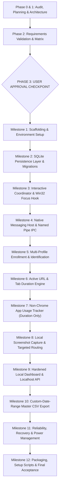

# Master Implementation Plan — Local Activity Tracker

> **Phased Implementation Roadmap, Risk Analysis, and Requirements Traceability**  
> *Target Execution: 18 Phased Milestones \| Strict Verification Hierarchy \| Interactive Session Architecture*

---

## 1. Implementation Philosophy & Governance

Following the **Gravitas Reliability Runtime** and the Master Prompt directives:
1. **Planning-First & Documentation-First:** No application code is written until Phases 0, 1, and 2 are fully completed and explicitly approved by the user (Phase 3 Checkpoint).
2. **Ground Before Mutating:** Read target files and existing dependencies before editing; never act on assumed file state.
3. **Evidence-Backed Verification:** Every milestone must be validated using deterministic commands (builds, tests, linters, or schema verifications) before being declared complete.
4. **Interactive Session Governance:** The Coordinator process is architected strictly for the logged-in interactive desktop session (Session 1+), never as a Session 0 service.
5. **Defense-in-Depth Local Security:** Localhost binding is paired with Host/Origin validation, CSRF headers, and capability tokens.

---

## 2. Phased Milestone Breakdown

---

### Phase 1: Repository Audit and Requirements Validation
- **Objective:** Audit existing environment, runtimes, dependencies, and validate requirements.
- **Scope:** Discovery of host OS (Windows 11), Node.js (v24.16.0), git, winget, Chrome installation, Chrome profile folders, and .NET 8 availability.
- **Dependencies:** None.
- **Deliverables:** Audit findings documented in `README.md`, `progress.md`, and planning docs.
- **Verification Method:** PowerShell environment inspection commands.
- **Acceptance Criteria:** Detailed knowledge of host machine capabilities and constraints documented.
- **Status:** COMPLETED.

---

### Phase 2: Architecture and Schema Approval (Reconciled)
- **Objective:** Formulate full technical architecture, database schema, API contracts, UI/UX designs, privacy boundaries, and testing strategy incorporating:
  1. Interactive user-session coordinator (Session 1+).
  2. Multi-host Named Pipe IPC architecture.
  3. Hardened localhost API security model.
  4. Minimal non-Chrome tracking (zero window titles).
- **Scope:** 12 core Markdown specifications created and reconciled in workspace root.
- **Deliverables:** Complete reconciled documentation suite.
- **Verification Method:** Cross-document consistency review and requirements matrix validation.
- **Acceptance Criteria:** Zero contradictions across specifications; all 4 technical corrections incorporated.
- **Status:** COMPLETED (Reconciliation Deliverables Generated).

---

### Phase 3: User Approval Checkpoint
- **Objective:** Present comprehensive audit, architectural decisions, milestone roadmap, and acceptance criteria to the user for formal approval.
- **Scope:** Halt all autonomous mutations. Await explicit user authorization.
- **Dependencies:** Completion of Phase 1 and Phase 2.
- **Acceptance Criteria:** Explicit user prompt affirming the architecture and authorizing Milestone 1 implementation.
- **Status:** PENDING APPROVAL.

---

### Milestone 1: Project Scaffolding and Development Environment
- **Objective:** Initialize source tree, install .NET 8 SDK if required, initialize .NET solution, C# projects, TypeScript extension workspace, and React dashboard workspace.
- **Scope:**
  - `src/Coordinator/` (.NET 8 Interactive Coordinator background/tray app).
  - `src/NativeHost/` (.NET 8 Native Messaging Stdio-to-NamedPipe bridge console app).
  - `src/ChromeExtension/` (Vite / TypeScript Manifest V3 workspace).
  - `src/LocalDashboard/` (Vite / React 18 / Tailwind CSS workspace).
  - `tests/LocalActivityTracker.Tests/` (xUnit test project).
- **Dependencies:** Explicit user approval (Phase 3).
- **Expected Deliverables:** `LocalActivityTracker.sln`, `package.json` configurations, clean build without errors.
- **Verification Method:** `dotnet build`, `npm run build` executed and passing.
- **Acceptance Criteria:** All sub-projects compile cleanly with zero errors.
- **Complexity:** Medium.

---

### Milestone 2: SQLite Schema and Persistence Layer
- **Objective:** Implement SQLite database engine, tables, migrations, and repository pattern in C#.
- **Scope:**
  - Initialize `%LOCALAPPDATA%\LocalActivityTracker\data\activity.db`.
  - Enable WAL journal mode and normal synchronous mode.
  - Create 10 core tables cleanly without `window_title`: `chrome_profiles`, `browser_windows`, `browser_sessions`, `url_activity_sessions`, `tab_events`, `screenshot_metadata`, `application_sessions`, `tracking_events`, `application_settings`, `schema_migrations`.
  - Implement migration runner and parameterized query repositories.
- **Dependencies:** Milestone 1 scaffolding.
- **Expected Deliverables:** `SqliteDatabaseContext.cs`, migration scripts `001_initial_schema.sql`, repository classes.
- **Verification Method:** Integration tests writing and reading mock records from SQLite.
- **Acceptance Criteria:** Database initialized, tables verified via `PRAGMA table_info`, indices verified, `window_title` absent.
- **Complexity:** Medium.

---

### Milestone 3: Interactive Coordinator Foundation & Win32 Focus Monitor
- **Objective:** Build interactive user session background engine and Win32 foreground window listener.
- **Scope:**
  - Interactive desktop session execution loop (Session 1+).
  - Win32 `SetWinEventHook(EVENT_SYSTEM_FOREGROUND)` P/Invoke integration.
  - Process resolution via `GetForegroundWindow()`, `GetWindowThreadProcessId()`, `QueryFullProcessImageName()`.
  - Session state tracking: `WTSRegisterSessionNotification` (`WTS_SESSION_LOCK` / `UNLOCK`).
- **Dependencies:** Milestone 2 persistence layer.
- **Expected Deliverables:** `FocusMonitor.cs`, `Win32Api.cs`, `SessionNotificationListener.cs`.
- **Verification Method:** Console test verifying foreground switch and lock events logged in real time.
- **Acceptance Criteria:** Focus changes received with sub-100ms latency in user desktop session.
- **Complexity:** High.

---

### Milestone 4: Native Messaging Host & Named Pipe IPC
- **Objective:** Build Native Messaging Host bridge and Coordinator Named Pipe server.
- **Scope:**
  - Stdio framing (uint32 LE + JSON max 1 MB) in `NativeHost`.
  - Named Pipe Server in Coordinator (`\\.\pipe\LocalActivityTracker-Coordinator-{SessionId}`).
  - Current-user DACL security descriptor and client PID validation.
  - Named Pipe framing (uint32 LE + JSON max 4 MB).
  - Reconnection loop and offline event buffering (up to 100 events).
- **Dependencies:** Milestone 2, Milestone 3.
- **Expected Deliverables:** `NativeMessagingBridge.cs`, `NamedPipeIpcServer.cs`, `NamedPipeIpcClient.cs`.
- **Verification Method:** Automated unit tests feeding framed messages across pipe and validating client SID.
- **Acceptance Criteria:** Stdio messages cleanly forwarded over pipe; non-user connections rejected.
- **Complexity:** High.

---

### Milestone 5: Chrome Extension Foundation & Multi-Profile Enrollment
- **Objective:** Build Chrome Manifest V3 extension with multi-profile identity management.
- **Scope:**
  - `manifest.json` (MV3, permissions: `tabs`, `windows`, `nativeMessaging`, `storage`).
  - Persistent `profile_id` UUID generation in `chrome.storage.local`.
  - Extension action popup for profile naming and connection status display.
  - Connection handshake over Stdio -> Named Pipe to Coordinator.
- **Dependencies:** Milestone 4 IPC.
- **Expected Deliverables:** Extension source code, compiled bundle in `src/ChromeExtension/dist`.
- **Verification Method:** Chrome loading unpacked extension, handshake logged in SQLite.
- **Acceptance Criteria:** Distinct `profile_id` records populated for multiple profiles.
- **Complexity:** Medium.

---

### Milestone 6: Active URL and Tab Duration Engine
- **Objective:** Accurately track active-tab URL visits, browser foreground duration, and tab switches.
- **Scope:**
  - Extension listeners: `chrome.tabs.onActivated`, `onUpdated`, `onRemoved`, `chrome.windows.onFocusChanged`.
  - Privacy URL sanitizer: strip sensitive parameters (`token`, `auth`, `password`, `code`, `secret`).
  - Coordinator Activity Arbiter: accrue active URL time **only** when Chrome is foregrounded and tab is active.
  - Background tab exclusion: time on non-active tabs or background profile windows is strictly zero.
- **Dependencies:** Milestone 5 extension foundation.
- **Expected Deliverables:** `ActivityArbiter.cs`, `TabTracker.ts`, URL sanitization unit tests.
- **Verification Method:** Automated duration test simulating tab switching and window unfocus.
- **Acceptance Criteria:** Zero duration accrued while Chrome is minimized, locked, or in background.
- **Complexity:** High.

---

### Milestone 7: Non-Chrome Application Usage Tracker (Duration Only)
- **Objective:** Track foreground durations of applications other than Chrome (Excel, VS Code, Teams, etc.).
- **Scope:**
  - Win32 focus monitor triggers `application_sessions` records upon focus switch away from Chrome.
  - Record: `ApplicationDisplayName`, `ProcessName`, `StartTimeUtc`, `EndTimeUtc`, `DurationSeconds`.
  - Strict privacy: **Zero window titles, zero document names, no keystrokes, no clipboard access.**
  - Exclude Chrome from non-Chrome application usage records.
- **Dependencies:** Milestone 3, Milestone 6.
- **Expected Deliverables:** `ApplicationUsageTracker.cs`, database repository.
- **Verification Method:** Automated tests verifying switching focus between Notepad and Chrome creates discrete, non-overlapping records without window titles.
- **Acceptance Criteria:** Non-Chrome app duration tracked accurately with zero window titles.
- **Complexity:** Medium.

---

### Milestone 8: Local Screenshot Capture & Targeted Routing Pipeline
- **Objective:** Periodic authorized visible-tab screenshots stored on local filesystem.
- **Scope:**
  - Default 10-minute configurable capture timer in Coordinator.
  - Dispatches `REQUEST_SCREENSHOT` over specific Named Pipe of the currently focused Chrome profile.
  - Extension calls `chrome.tabs.captureVisibleTab(null, { format: 'png' })`.
  - Base64 image decoded and saved to `%LOCALAPPDATA%\LocalActivityTracker\screenshots\{profile_id}_{timestamp}.png`.
  - Record metadata in `screenshot_metadata` (status: `SUCCESS`, `RESTRICTED`, `WINDOW_OCCLUDED`, `FAILED`).
  - Strict safety: No desktop screenshots; no captures of non-Chrome apps; no images in diagnostic logs.
- **Dependencies:** Milestone 4, Milestone 6.
- **Expected Deliverables:** `ScreenshotManager.cs`, extension capture handler, filesystem storage pipeline.
- **Verification Method:** Capture execution tests on normal and restricted tabs (`chrome://version`).
- **Acceptance Criteria:** Screenshots stored locally; restricted pages recorded with honest failure status.
- **Complexity:** High.

---

### Milestone 9: Hardened Local Dashboard & Localhost API Gateway
- **Objective:** Build local React dashboard and hardened embedded Kestrel API server.
- **Scope:**
  - ASP.NET Core Minimal API listening strictly on `127.0.0.1:48120`.
  - Host header validation (`127.0.0.1:48120` / `localhost:48120`).
  - Origin header validation (reject unauthorized cross-origin requests).
  - CSRF header requirement (`X-LAT-Requested-With: LocalActivityTracker`).
  - Capability Bearer Token authentication (`auth.token`).
  - React 18 + Tailwind dashboard with Overview KPI cards, Chrome Activity timeline, Screenshot Gallery, App Usage breakdown (no window titles), and Profile Management.
- **Dependencies:** Milestone 2, Milestone 6, Milestone 7, Milestone 8.
- **Expected Deliverables:** `LocalApiServer.cs`, React dashboard app in `src/LocalDashboard`.
- **Verification Method:** Browser tests navigating all dashboard views, verifying offline rendering and token authentication.
- **Acceptance Criteria:** Secure localhost dashboard displays live SQLite activity and local screenshots.
- **Complexity:** High.

---

### Milestone 10: Custom Date Range Master CSV Export
- **Objective:** Implement unified multi-profile CSV export for custom date ranges.
- **Scope:**
  - Date range selector (Start Date, End Date in local time converted to UTC).
  - Multi-profile selector and section checkboxes.
  - Single CSV output containing:
    1. `REPORT_METADATA`
    2. `PROFILE_SUMMARY`
    3. `CHROME_PROFILE` (per enrolled profile)
    4. `SCREENSHOT_METADATA`
    5. `NON_CHROME_APPLICATION_USAGE` (executable & duration only; zero window titles)
  - Date boundary clipping math: clip durations to selected range without fabricating timestamps.
  - Formula injection defense: prefix `=`, `+`, `-`, `@`, `\t`, `\r` with `'`.
- **Dependencies:** Milestone 9 dashboard & API.
- **Expected Deliverables:** `CsvExportService.cs`, UI export modal with progress indicator.
- **Verification Method:** Automated unit tests verifying date boundary math, formula sanitization, and Excel import compatibility.
- **Acceptance Criteria:** Valid RFC 4180 CSV generated containing actual SQLite data.
- **Complexity:** High.

---

### Milestone 11: Reliability, Recovery & Power Management
- **Objective:** Ensure zero data loss during sleep, crashes, or abrupt termination.
- **Scope:**
  - Windows `WTSRegisterSessionNotification` & `PowerModeChanged`: flush sessions on Lock/Suspend.
  - Coordinator startup crash recovery: auto-close dangling uncompleted sessions with last known heartbeat.
  - Database WAL checkpointing and automatic backup routines (`VACUUM INTO`).
- **Dependencies:** Milestone 2, Milestone 3, Milestone 6.
- **Expected Deliverables:** `PowerLifecycleManager.cs`, `CrashRecoveryService.cs`.
- **Verification Method:** Test simulating process kill and verifying recovery flag on subsequent startup.
- **Acceptance Criteria:** No dangling sessions; recovered sessions explicitly marked `RECOVERED_AFTER_CRASH`.
- **Complexity:** Medium.

---

### Milestone 12: Packaging, Setup Scripts & Final Acceptance
- **Objective:** Author reproducible installation and uninstallation scripts for Windows 10/11.
- **Scope:**
  - PowerShell installer script: `scripts/install.ps1` (registers Native Host manifest, sets up Startup shortcut).
  - Uninstaller script: `scripts/uninstall.ps1`.
  - Comprehensive end-to-end verification against all 15 master prompt criteria.
- **Dependencies:** All previous milestones.
- **Expected Deliverables:** Production scripts and final verification report.
- **Verification Method:** Clean test run of `install.ps1` registering registry keys and verifying Coordinator launch.
- **Acceptance Criteria:** Single-command setup successfully configures system; all acceptance criteria satisfied.
- **Complexity:** Medium.

---

## 3. Requirements Traceability Matrix (Reconciled)

| Requirement ID | Master Requirement Description | Architectural Component | Database / Schema Impact | Task ID | Verification Method |
| :--- | :--- | :--- | :--- | :--- | :--- |
| **REQ-001** | Local-first, 100% offline (no cloud/VPS) | Interactive Coordinator, React Dashboard | SQLite local storage only | `TASK-001`, `TASK-049`, `TASK-069` | Static code audit; network port check (loopback only) |
| **REQ-002** | Multi-profile Chrome tracking | Extension `profile.ts`, Native Host, Named Pipe | `chrome_profiles` table | `TASK-025` - `TASK-030` | Multi-profile enrollment tests in Default & Profile 1 |
| **REQ-003** | Active URL time tracking | Activity Arbiter, Win32 Focus Monitor | `url_activity_sessions` | `TASK-031` - `TASK-037` | Tab switch and window unfocus duration tests |
| **REQ-004** | Chrome foreground duration tracking | Win32 Focus Monitor, Activity Arbiter | `browser_sessions` | `TASK-035` | Foreground focus duration tests |
| **REQ-005** | Non-Chrome app duration (NO window titles) | Focus Monitor, App Tracker | `application_sessions` (NO `window_title`) | `TASK-038` - `TASK-042` | Focus switch to Notepad/Excel; assert no titles stored |
| **REQ-006** | 10m periodic authorized tab screenshots | Coordinator Scheduler, Named Pipe Router | `screenshot_metadata`, `%LOCALAPPDATA%\screenshots` | `TASK-043` - `TASK-048` | Capture execution tests; restricted page tests |
| **REQ-007** | Local SQLite storage & migrations | DataRepository, Migration Runner | 10 SQLite tables | `TASK-011` - `TASK-014` | SQLite integration tests; WAL verification |
| **REQ-008** | Hardened Local React Dashboard | React 18, Vite, Tailwind CSS | Kestrel loopback API (`127.0.0.1:48120`) | `TASK-049` - `TASK-056` | UI rendering, Host/Origin tests, token auth |
| **REQ-009** | Unified CSV export (custom date range) | CsvExportService | Query builder with boundary clipping | `TASK-057` - `TASK-063` | CSV generator unit tests; RFC 4180 validation |
| **REQ-010** | Date boundary duration clipping | CsvExportService math engine | Boundary calculation queries | `TASK-059` | Boundary clipping math unit tests |
| **REQ-011** | CSV formula injection protection | RFC 4180 Formatter | String sanitization | `TASK-060` | Unit test with `=`, `+`, `-`, `@` injection payloads |
| **REQ-012** | URL sensitive parameter redaction | Extension Sanitizer, Coordinator Filter | Redacted URL stored in SQLite | `TASK-032`, `TASK-067` | URL redaction test suite with auth tokens |
| **REQ-013** | Honest reporting of failed/restricted captures | Screenshot Manager | `screenshot_metadata.status` | `TASK-046` | Capture test on `chrome://extensions` |
| **REQ-014** | Interactive Session lock & crash recovery | PowerLifecycleManager, RecoveryService | `session_status = 'RECOVERED'` | `TASK-064`, `TASK-065` | WTS Session Lock test & simulated crash test |
| **REQ-015** | Reproducible Windows setup & registration | PowerShell Scripts | Registry `HKCU\Software\Google\Chrome` | `TASK-070` - `TASK-072` | Execution of `install.ps1` on clean environment |
